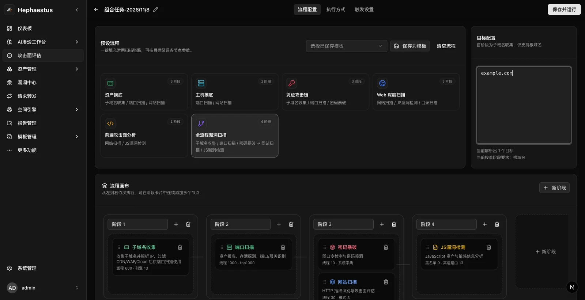
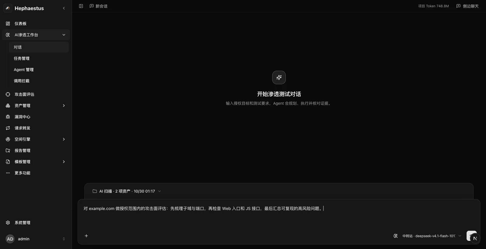
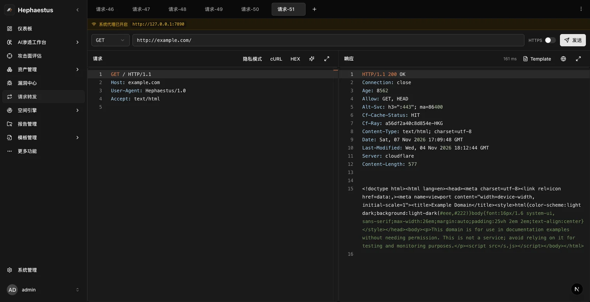
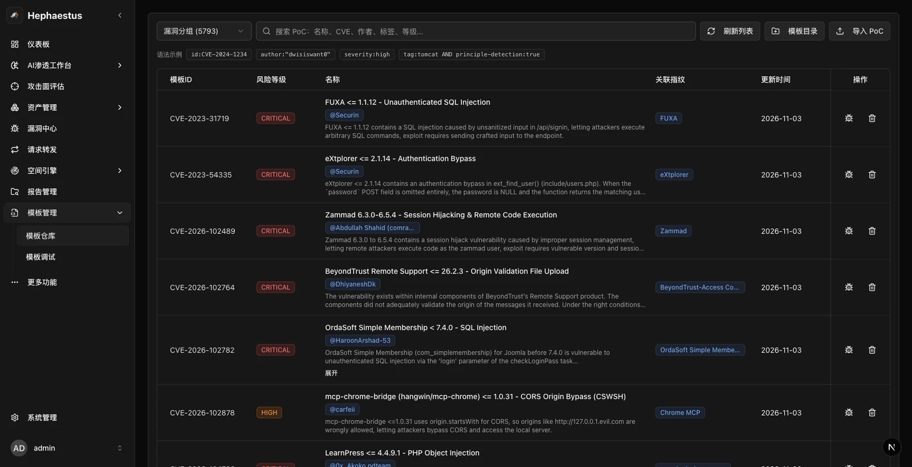
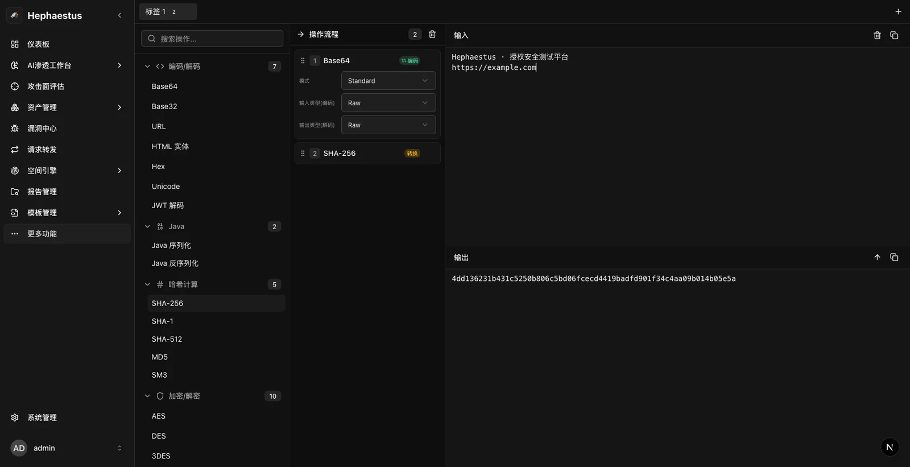
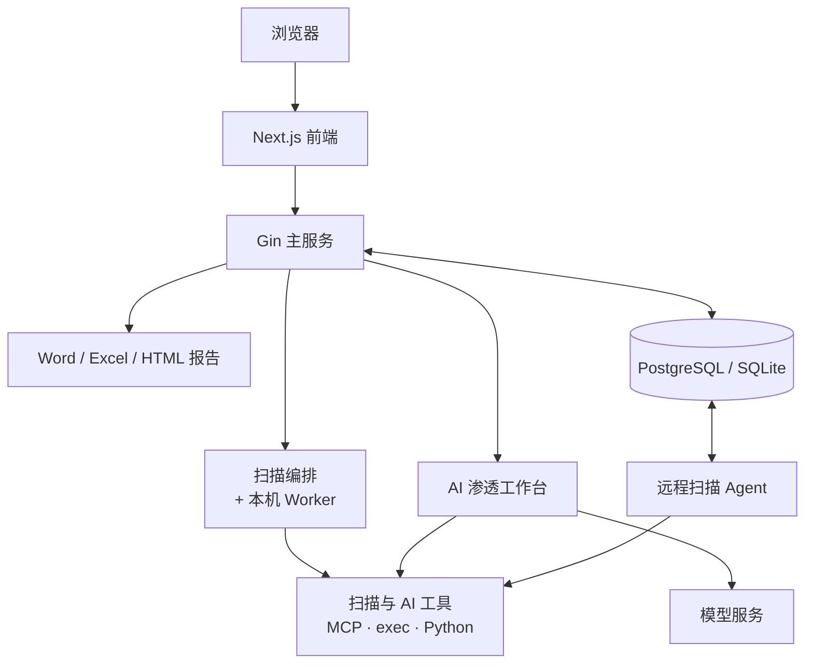

<div align="center">


<h1>Hephaestus</h1>

<p><b>资产收集 · 攻击面评估 · 漏洞验证 · AI 渗透对话</b></p>

<p>把扫描编排、AI 工具调用与分布式节点，锻造进同一个安全测试工作台。</p>

<p>
  <a href="https://github.com/qiwentaidi/Hephaestus/releases"></a>
  <a href="LICENSE"></a>
  
  
  
  <a href="https://github.com/qiwentaidi/Hephaestus"></a>
</p>

<p>
  <a href="#快速开始"><b>快速开始</b></a> ·
  <a href="#界面预览"><b>界面预览</b></a> ·
  <a href="#核心能力"><b>核心能力</b></a> ·
  <a href="#架构"><b>架构</b></a> ·
  <a href="#文档"><b>文档</b></a> ·
  <a href="https://github.com/qiwentaidi/Hephaestus/releases"><b>下载</b></a>
</p>

<p>
  <a href="README_EN.md">English</a> · <b>中文</b>
</p>

</div>

> [!IMPORTANT]
> Hephaestus 仅用于**已获得明确授权**的安全测试。发起任何探测前，请确认目标、时间窗口与允许的手段，并阅读 [授权测试与风险条款](docs/authorized-testing.md)。

Hephaestus 是一个前后端一体的安全测试平台：前端使用 Next.js，后端使用 Gin，提供 **Web 服务**、**桌面客户端**和**独立扫描 Agent** 三种形态。它把资产收集、攻击面评估、漏洞验证与 AI 渗透对话放在同一个工作区，让一次授权测试从发现、验证到报告形成闭环。

## 界面预览

<table>
  <tr>
    <td width="50%" align="center" valign="top">
      
      <br />
      <sub><b>组合任务</b> · 资产摸底、端口、密码暴破、网站与 JS 扫描按阶段编排</sub>
    </td>
    <td width="50%" align="center" valign="top">
      
      <br />
      <sub><b>AI 工作台</b> · 输入授权目标与测试要求，由 Agent 规划并调用工具</sub>
    </td>
  </tr>
  <tr>
    <td width="50%" align="center" valign="top">
      
      <br />
      <sub><b>请求转发</b> · 编辑请求、查看响应，保存常用请求标签页</sub>
    </td>
    <td width="50%" align="center" valign="top">
      
      <br />
      <sub><b>模板管理</b> · 检索、调试 Nuclei 模板并做 OOB 连通性测试</sub>
    </td>
  </tr>
</table>

<p align="center">
  
  <br />
  <sub><b>分析工具</b> · 编解码、哈希、JWT、加解密等操作可组合成处理流水线</sub>
</p>

## 核心能力

| 模块 | 能力 |
| --- | --- |
| **攻击面评估** | 子域名收集、端口与服务识别、网站指纹与漏洞、目录扫描、弱口令检测、JS/API 发现；支持组合任务与阶段编排 |
| **AI 渗透工作台** | 项目与会话、工具调用、图片输入、测试过程记录与证据查看；支持 AI 批量任务与队列管理 |
| **漏洞中心** | 汇总扫描与 AI 发现，按来源、级别与状态筛选，记录复现步骤和证据，跟踪人工处置 |
| **资产管理** | 资产中心、资产拓扑与地图，集中查看 IP、端口、子域名、网站等收集结果 |
| **空间引擎** | FOFA、Hunter、Quake 等空间引擎的查询与聚合搜索，查看历史、配额并导出结果 |
| **企业信息** | 企业及关联资产收集，支持 Excel 导出与合并导出 |
| **请求转发** | HTTP 请求编辑与响应查看、标签页保存、cURL/HEX 视图、Nuclei 模板润色与调试 |
| **模板管理** | Nuclei 模板检索、编辑、扩展目录、调试与 OOB 连通性测试 |
| **报告管理** | 多任务批量导出 Word / Excel / HTML，自定义导出名称 |
| **分析工具** | 覆盖常见 CyberChef 场景的编解码、JWT、API 文档测试、文本比较、杀软识别、数据库信息采集与密钥管理；桌面端支持小程序反编译 |
| **任务与节点** | 并发控制、暂停/恢复/取消、历史与计划任务、参数模板；Agent 注册、心跳、角色容量与版本更新 |
| **系统管理** | 扫描设置、API密钥、AI 配置、扫描模板、字典管理、消息通知、后端日志、系统更新与配置迁移 |

## 架构



> 下图为 Web / 分布式部署形态。Web 服务与扫描 Agent 通过同一套 PostgreSQL 交换任务、心跳和结果；Agent 通过主服务接口使用平台工具与资源同步。桌面客户端内置同一套服务，默认使用本地 SQLite。模型服务、空间引擎与 AI 工具均按你的配置接入。

## 快速开始

### 选择运行方式

| 方式 | 适合场景 | 数据存储 | 默认入口 |
| --- | --- | --- | --- |
| **单二进制**（推荐） | 常规部署、生产环境、离线运行 | PostgreSQL 或 SQLite | `http://localhost:18181` |
| **Docker Compose** | 团队共享、服务器部署、快速体验 | 内置 PostgreSQL 17，可切 SQLite 或外部 PostgreSQL | `http://localhost:18181` |
| **桌面客户端** | 单机使用、本地工具整合 | SQLite，可切换 PostgreSQL | 桌面窗口 |
| **扫描 Agent** | 分布式扫描、远程网络执行 | 与主服务共享 PostgreSQL | 无 Web 入口 |

### 1. 单二进制（推荐）

常规部署推荐从源码编译单二进制。前端会静态导出并嵌入后端二进制，部署机器无需安装 Node.js 或 Go。

在仓库根目录构建并运行：

```bash
./scripts/build.sh current
./dist/hephaestus-darwin-arm64   # 以 macOS ARM64 为例
```

也可以从 [Releases](https://github.com/qiwentaidi/Hephaestus/releases) 下载对应平台的预编译压缩包。

首次运行会在 `~/.config/hephaestus/config.yaml` 生成默认配置；如果默认 PostgreSQL 尚未准备好，程序会提示数据库连接失败，完成数据库配置后重启即可。

默认监听 `http://localhost:18181`。生产环境建议显式指定配置目录和固定的 JWT 密钥：

```bash
HEPHAESTUS_CONFIG_DIR=/opt/hephaestus \
HEPHAESTUS_JWT_SECRET='固定的随机长字符串' \
./dist/hephaestus-darwin-arm64
```

<details>
<summary><b>构建全部平台 / 只构建前端或后端</b></summary>

```bash
./scripts/build.sh all        # Windows、macOS、Linux 多平台产物
./scripts/build.sh frontend   # 只构建前端并复制到 backend/webassets/dist
./scripts/build.sh backend    # 复用已有前端产物构建后端
```

Linux 目标通过 Docker Buildx 构建，需要本机 Docker 服务。

</details>

### 2. Docker Compose

发布版 Compose 部署接入宿主机更新器后，可在页面内升级。详见 [Docker 升级](docs/docker-deployment.md#升级)。

镜像默认内置 PostgreSQL 17，启动后只有一个 `hephaestus` 容器。环境要求：Docker 24+（含 Compose V2），建议预留 2 GB 以上内存；镜像约 430 MB。

在仓库根目录执行：

```bash
cp .env.example .env   # 可选：调整端口与数据库
docker compose up -d --build

curl -fsS http://localhost:18181/healthz
```

打开 `http://localhost:18181`，首次访问会引导创建管理员账号。

<details>
<summary><b>数据持久化与常用操作</b></summary>

数据保存在 Compose 卷 `hephaestus-data`（默认完整名称为 `<项目名>_hephaestus-data`），挂载到容器内 `/var/lib/hephaestus`：

```text
config.yaml     应用配置
.pg-password    内置 PostgreSQL 密码
.jwt-secret     服务端 JWT 密钥
pgdata/         PostgreSQL 数据
data/           上传文件、截图等
logs/           应用与 PostgreSQL 日志
```

只要继续挂载同一个数据卷，`docker compose up -d --build` 重建容器时就会保留内置 PostgreSQL 数据。更改 Compose 项目名可能会挂载一个新卷。

```bash
docker compose ps
docker compose logs -f hephaestus
docker compose down       # 停止并保留数据
docker compose down -v    # 停止并删除数据卷（谨慎）
```

</details>

<details>
<summary><b>切换 SQLite 或外部 PostgreSQL</b></summary>

**SQLite：**

```bash
HEPHAESTUS_DB_TYPE=sqlite docker compose up -d
```

SQLite 文件位于数据卷的 `data/hephaestus.db`。适合单机轻量使用；分布式 Agent 需要共享 PostgreSQL。

**外部 PostgreSQL：** 关闭内置数据库并填写连接信息：

```yaml
services:
  hephaestus:
    environment:
      HEPHAESTUS_EMBEDDED_POSTGRES: "0"
      HEPHAESTUS_DB_HOST: postgres
      HEPHAESTUS_DB_PORT: "5432"
      HEPHAESTUS_DB_USER: postgres
      HEPHAESTUS_DB_PASSWORD: "你的密码"
      HEPHAESTUS_DB_NAME: hephaestus
```

> 环境变量只在数据卷中还没有 `config.yaml` 时生效；已有配置时以 `config.yaml` 为准。默认内置 PostgreSQL 只监听容器内 `127.0.0.1:5432`，不会占用宿主机的 5432。

</details>

<details>
<summary><b>不用 Compose：Docker 单容器</b></summary>

```bash
docker build -t hephaestus:local .

docker run -d --name hephaestus \
  -p 18181:18181 \
  -v hephaestus-data:/var/lib/hephaestus \
  --shm-size=256m \
  --restart unless-stopped \
  hephaestus:local
```

容器内同样内置 PostgreSQL，不需要额外启动数据库容器。查看状态与日志：

```bash
docker ps
docker logs -f hephaestus
```

</details>

### 3. 桌面客户端

桌面端基于 Wails 3，内置本地服务，默认使用 SQLite，本地后端端口为 `38456`。安装包从 [Hephaestus-Desktop](https://github.com/qiwentaidi/Hephaestus-Desktop) 获取。

各平台需要对应的原生工具链：macOS 的 Xcode Command Line Tools、Windows 的 WebView2、Linux 的 GTK/WebKit 开发库。

开发模式：

```bash
go install github.com/wailsapp/wails/v3/cmd/wails3@v3.0.0-alpha.78
cd backend/cmd/desktop
wails3 task dev
```

打包当前平台：

```bash
cd backend/cmd/desktop
wails3 task package
```

在仓库根目录构建多平台安装包：

```bash
./scripts/build-desktop-release.sh
```

多平台安装包产物默认位于 `dist/desktop/`。

- 默认配置：`~/.config/hephaestus/config-desktop.yaml`
- 默认数据库：`~/.config/hephaestus/data/hephaestus.db`
- 首选端口：`HEPHAESTUS_DESKTOP_BACKEND_PORT`；端口被占用时自动使用临时端口
- 独立设置窗口：顶部齿轮打开，与应用内设置页共用设置组件
- 桌面专属入口：本地启动器、小程序反编译

Web 与桌面使用不同配置文件，但默认配置目录相同；需要隔离数据时分别设置 `HEPHAESTUS_CONFIG_DIR`。

### 4. 本地开发

前后端分离运行，适合修改代码。在仓库根目录打开两个终端。

| 依赖 | 要求 |
| --- | --- |
| Go | 1.26.3+ |
| Node.js | 22+，带 npm |
| PostgreSQL | 17（也可使用 SQLite） |
| libpcap | 端口扫描依赖；macOS `brew install libpcap`，Ubuntu `libpcap-dev`，Windows 安装 Npcap |

```bash
# 终端 1：后端，默认 8080
cd backend
go run -tags dev .

# 终端 2：前端，默认 3000
cd frontend
npm ci
npm run dev
```

打开 `http://localhost:3000`。前端默认连接 `8080`；后端端口变化时，用 `NEXT_PUBLIC_BACKEND_PORT` 指定：

```bash
NEXT_PUBLIC_BACKEND_PORT=8081 npm run dev
```

​	

<details>
<summary><b>没有 PostgreSQL？用 SQLite 启动后端</b></summary>

```bash
cd backend
mkdir -p .dev-config
cat > .dev-config/config.yaml <<EOF
web:
  port: 8080
database:
  type: sqlite
  path: "$(pwd)/.dev-config/hephaestus.db"
EOF

HEPHAESTUS_CONFIG_DIR="$(pwd)/.dev-config" go run -tags dev .
```

</details>

<details>
<summary><b>用 Docker 启动一个开发用 PostgreSQL</b></summary>

如果本机 5432 已被占用，可以映射到 5433：

```bash
export POSTGRES_PASSWORD="$(openssl rand -hex 24)"
docker run -d --name hephaestus-dev-pg \
  -p 127.0.0.1:5433:5432 \
  -e POSTGRES_PASSWORD \
  -e POSTGRES_DB=hephaestus \
  -v hephaestus-dev-pg:/var/lib/postgresql/data \
  postgres:17-alpine
```

然后在 `.dev-config/config.yaml` 中写入连接信息并启动后端：

```bash
mkdir -p .dev-config
(umask 077
cat > .dev-config/config.yaml <<EOF
web:
  port: 8080
database:
  type: postgres
  host: 127.0.0.1
  port: "5433"
  user: postgres
  password: "$POSTGRES_PASSWORD"
  dbname: hephaestus
  sslmode: disable
EOF
)

HEPHAESTUS_CONFIG_DIR="$(pwd)/.dev-config" go run -tags dev .
```

</details>

更多说明见 [本地开发与原生运行](docs/local-development.md)。

### 5. 扫描 Agent（可选）

单机部署不需要 Agent。需要把扫描或 AI 工具执行放到独立节点时，才部署 Agent。节点需要能连接主服务使用的 PostgreSQL。

Linux / macOS 安装：

```bash
curl -fsSL 'https://your-server/api/v1/agent/install.sh' -o install.sh
bash install.sh --server 'https://your-server'
```

Windows 可在「工作节点管理」页下载安装器，或使用：

```powershell
Invoke-WebRequest -Uri 'https://your-server/api/v1/agent/install.bat' -OutFile install.bat
.\install.bat -Server 'https://your-server'
```

从源码构建：

```bash
cd backend
mkdir -p bin
go build -o bin/hephaestus-agent ./cmd/scan-agent

HEPHAESTUS_CONFIG_DIR=/path/to/agent-config \
AGENT_ROLES=ai,scan \
./bin/hephaestus-agent
```

完整要求、systemd 安装、批量更新与回滚见 [Agent 下载、安装与更新](docs/agent-installation.md) 和 [Hephaestus-Agent](https://github.com/qiwentaidi/Hephaestus-Agent)。

## 首次使用

登录后，按需完成以下配置：

1. **扫描资源**：进入「系统设置 → 系统更新」，通过「配置文件更新」下载或更新 PoC、目录字典和弱口令字典。
2. **空间引擎**：使用 FOFA、Hunter、Quake 等服务前，在「系统设置 → API密钥」填写对应 Key。
3. **AI 工作台**：在「系统设置 → AI 配置」填写渠道、API 地址、Key 和模型，并测试连接。
4. **远程节点**：使用 Agent 前，准备主服务与节点共用的 PostgreSQL，并按 [Agent 文档](docs/agent-installation.md) 部署节点。

完成后即可创建扫描任务，或在 AI 工作台中新建会话并说明授权目标与测试范围。

## 配置速查

| 项目 | 默认值 |
| --- | --- |
| Web 生产端口 | `18181` |
| 本地开发后端 | `8080` |
| 本地开发前端 | `3000` |
| 桌面端本地服务 | `38456` |
| 配置文件（原生） | `~/.config/hephaestus/config.yaml` |
| 配置目录覆盖 | `HEPHAESTUS_CONFIG_DIR` |
| Docker 数据目录 | `/var/lib/hephaestus` |
| 健康检查 | `GET /healthz` |

<details>
<summary><b>常用环境变量</b></summary>

| 变量 | 说明 |
| --- | --- |
| `HEPHAESTUS_CONFIG_DIR` | 配置、日志与数据目录 |
| `HEPHAESTUS_DB_TYPE` | `postgres` 或 `sqlite` |
| `HEPHAESTUS_DB_HOST` | 数据库主机；Docker 中 `local` 表示内置 PostgreSQL |
| `HEPHAESTUS_DB_PORT` | 数据库端口 |
| `HEPHAESTUS_DB_USER` | 数据库用户 |
| `HEPHAESTUS_DB_PASSWORD` | 数据库密码 |
| `HEPHAESTUS_DB_NAME` | 数据库名 |
| `HEPHAESTUS_DB_SSLMODE` | PostgreSQL SSL 模式 |
| `HEPHAESTUS_EMBEDDED_POSTGRES` | Docker 中设为 `0` 关闭内置 PostgreSQL |
| `HEPHAESTUS_PORT` | 仅 Compose 使用的主机映射端口 |
| `HEPHAESTUS_JWT_SECRET` | JWT 签名密钥；生产环境建议固定 |
| `HEPHAESTUS_AI_ENFORCE_EGRESS` | 设为 `1` 启用 Docker 出口网关，默认关闭 |
| `HEPHAESTUS_EGRESS_IMAGE` | 出口网关镜像名，默认 `hephaestus-egress:local` |
| `HEPHAESTUS_DESKTOP_BACKEND_PORT` | 桌面端首选本地端口 |
| `PORT` | 开发入口的 Web 端口；生产二进制读取 `config.yaml` 的 `web.port` |

> `HEPHAESTUS_DB_*` 由 Docker entrypoint 用于生成初始 `config.yaml`；原生二进制与 Agent 直接读取 `config.yaml`。已有配置时以配置文件为准。

> 原生二进制未设置 `HEPHAESTUS_JWT_SECRET` 时，每次重启会生成新的签名密钥，已登录用户需要重新登录；Docker 镜像会自动生成并持久化 `.jwt-secret`。

</details>

<details>
<summary><b>可选：Docker 出口网关</b></summary>

默认的 `toolguard` 只做调用前规则检查，不依赖 Docker。需要把命令、Python 和原生 HTTP 请求放进隔离网络执行时，才启用 Docker 出口网关。当前 Web 运行镜像未安装 Docker CLI，也没有挂载 Docker socket，建议在宿主机原生运行时启用：

```bash
./deploy/egress/build.sh
HEPHAESTUS_AI_ENFORCE_EGRESS=1 ./dist/hephaestus-darwin-arm64
```

执行期间可用 `docker ps --filter label=hephaestus.egress=1` 查看临时网关与 Worker 容器；结束后自动清理。出口镜像默认只预装 Python、pip 和 requests，可在 [deploy/egress/Dockerfile](deploy/egress/Dockerfile) 中补充工具。详见 [本地开发与原生运行](docs/local-development.md) 的「可选的 AI 工具出口网关」一节。

</details>

## 常见问题

<details>
<summary><b>Docker 启动后一直是 unhealthy</b></summary>

```bash
docker compose logs hephaestus
docker exec hephaestus tail -n 100 /var/lib/hephaestus/logs/postgresql.log
```

首次初始化 PostgreSQL 和执行数据库迁移需要几十秒，等待健康检查通过即可。

</details>

<details>
<summary><b>本地后端提示数据库连接失败</b></summary>

确认 PostgreSQL 已启动，并在 `config.yaml` 中填写正确的主机、端口、用户名和密码。单机开发也可以使用上面的 SQLite 配置。

</details>

<details>
<summary><b>前端页面能打开，但接口 404 / 连接失败</b></summary>

确认后端运行在 `8080`，或通过 `NEXT_PUBLIC_BACKEND_PORT` 指定实际端口。

</details>

<details>
<summary><b>端口扫描不可用</b></summary>

确认构建环境安装了 libpcap / Npcap，并使用 CGO 构建；Linux 发布构建应使用 `./scripts/build.sh`，而不是手动 `CGO_ENABLED=0 go build`。

</details>

<details>
<summary><b>Docker 内页面更新按钮不可用</b></summary>

源码构建部署可在宿主机重建镜像。需要从页面升级时，请按 [Docker 升级](docs/docker-deployment.md#升级) 接入宿主机更新器。

</details>

<details>
<summary><b>浏览器截图不可用</b></summary>

截图依赖可用的 Chromium 浏览器及其运行环境。Linux Server 和精简容器需检查浏览器、字体及图形依赖。

</details>

<details>
<summary><b>AI 本地命令无法执行</b></summary>

AI 会话中的本地命令和交互终端采用文件写入隔离，产物写入会话工作目录。macOS 使用 `sandbox-exec`，Linux 使用 Bubblewrap（`bwrap`）；缺少隔离工具或初始化失败时会拒绝执行。

</details>

<details>
<summary><b>TCP 发现和 SYN 权限</b></summary>

当前 TCP 发现默认使用 Connect 模式。选择 SYN 时检查系统权限、抓包依赖及 SYN 能力状态，需要时通过平台授权入口启用。

</details>

## 项目结构

```text
backend/                 Gin 后端、扫描引擎、AI 工作台与 Agent
frontend/                Next.js 前端
docker/                  Docker entrypoint
deploy/egress/           AI 工具出口网关
docs/                    设计、部署与授权文档
scripts/                 构建、发布与安装脚本
Dockerfile               Web 运行镜像（内置 PostgreSQL）
docker-compose.yml       单容器 Compose 部署
```

## 文档

| 文档 | 内容 |
| --- | --- |
| [Docker 部署](docs/docker-deployment.md) | 内置 PostgreSQL、数据卷、备份恢复、健康检查与升级 |
| [本地开发与原生运行](docs/local-development.md) | 前后端开发、单二进制、桌面端与出口网关 |
| [Agent 下载、安装与更新](docs/agent-installation.md) | 五平台安装、systemd、批量更新与回滚 |
| [构建与发布脚本](scripts/README.md) | Web、Agent、桌面端构建与发布入口 |
| [授权测试与风险条款](docs/authorized-testing.md) | 测试前、中、后的授权与数据要求 |

## 参与贡献

欢迎通过 [Issue](https://github.com/qiwentaidi/Hephaestus/issues) 反馈问题，或提交 Pull Request。

- 后端：`cd backend && go test ./...`
- 前端：`cd frontend && npm run lint`
- 涉及扫描、AI 工具或 Agent 行为变更时，请在 PR 中说明授权边界、影响范围与验证方式。

## 安全与授权

Hephaestus 的扫描、漏洞验证、AI 工具调用和 Agent 执行都应在合法授权范围内开展。涉及客户资产或第三方系统时，测试方必须在发起任何探测前取得明确书面授权。

- **测试前**：约定目标、时间窗口、允许的手段、并发或速率上限、应急联系人与停测条件。
- **测试中**：将手动任务、组合任务、AI 工具和各 Agent 限制在约定范围内；发现越界或异常影响时立即停止。
- **测试后**：仅保留验证和报告所需的证据，对凭据、个人信息和敏感数据脱敏，按约定删除临时产物。

完整条款见 [授权测试与风险条款](docs/authorized-testing.md)。

<div align="center">
<br />
<sub>Hephaestus · 为授权安全测试而锻造</sub>
</div>
