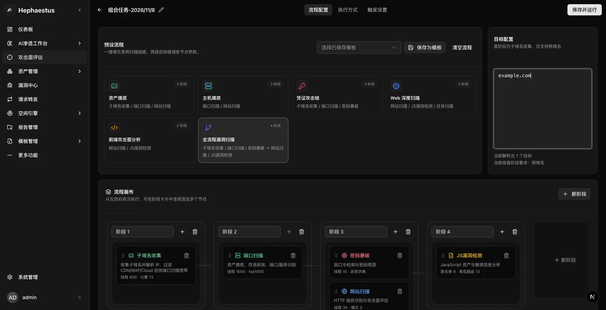
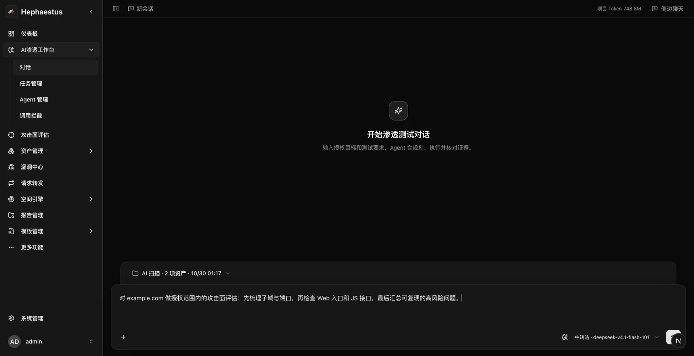
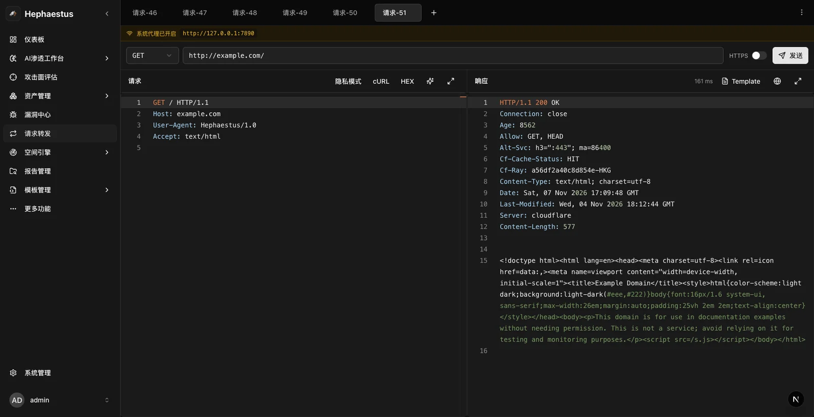
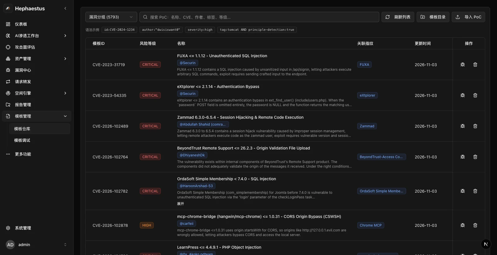
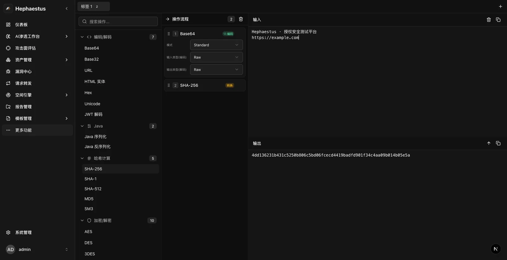
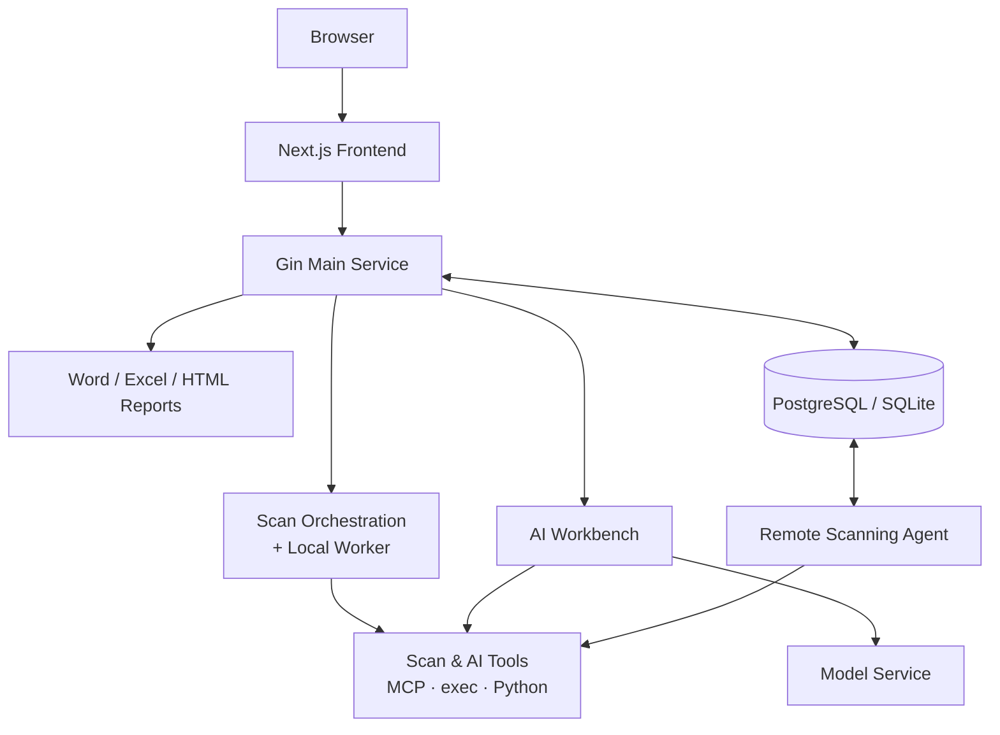

<div align="center">


<h1>Hephaestus</h1>

<p><b>Asset Discovery · Attack Surface Assessment · Vulnerability Validation · AI Pentest Conversations</b></p>

<p>Forge scan orchestration, AI tooling, and distributed nodes into a single security testing workbench.</p>

<p>
  <a href="https://github.com/qiwentaidi/Hephaestus/releases"></a>
  <a href="LICENSE"></a>
  
  
  
  <a href="https://github.com/qiwentaidi/Hephaestus"></a>
</p>

<p>
  <a href="#quick-start"><b>Quick Start</b></a> ·
  <a href="#screenshots"><b>Screenshots</b></a> ·
  <a href="#features"><b>Features</b></a> ·
  <a href="#architecture"><b>Architecture</b></a> ·
  <a href="#documentation"><b>Docs</b></a> ·
  <a href="https://github.com/qiwentaidi/Hephaestus/releases"><b>Download</b></a>
</p>

<p>
  <b>English</b> · <a href="README.md">中文</a>
</p>

</div>

> [!IMPORTANT]
> Hephaestus is intended **only** for security testing with explicit authorization. Before sending any probe, confirm the targets, time window, and permitted techniques, and read [Authorized Testing and Risk Terms](docs/authorized-testing.md).

Hephaestus is a full-stack security testing platform: Next.js on the frontend, Gin on the backend, available as a **web service**, a **desktop client**, and a **standalone scanning Agent**. It brings asset discovery, attack surface assessment, vulnerability validation, and AI pentest conversations into a single workspace, closing the loop from discovery to validation to reporting for an authorized engagement.

## Screenshots

<table>
  <tr>
    <td width="50%" align="center" valign="top">
      
      <br />
      <sub><b>Combined Tasks</b> · Orchestrate asset discovery, ports, password brute-force, web, and JS scanning in stages</sub>
    </td>
    <td width="50%" align="center" valign="top">
      
      <br />
      <sub><b>AI Workbench</b> · Describe an authorized target and testing requirements; the Agent plans and calls tools</sub>
    </td>
  </tr>
  <tr>
    <td width="50%" align="center" valign="top">
      
      <br />
      <sub><b>Request Repeater</b> · Edit requests, inspect responses, and keep frequently used request tabs</sub>
    </td>
    <td width="50%" align="center" valign="top">
      
      <br />
      <sub><b>Template Management</b> · Search and debug Nuclei templates and run OOB connectivity tests</sub>
    </td>
  </tr>
</table>

<p align="center">
  
  <br />
  <sub><b>Analysis Tools</b> · Chain encoding, hashing, JWT, encryption, and other operations into a processing pipeline</sub>
</p>

## Features

| Module | Capabilities |
| --- | --- |
| **Attack Surface Assessment** | Subdomain discovery, port and service identification, web fingerprinting and vulnerability scanning, directory scanning, weak-password testing, and JS/API discovery; supports combined tasks and stage orchestration |
| **AI Workbench** | Projects and sessions, tool calls, image input, test records, and evidence review; supports AI batch tasks and queue management |
| **Vulnerability Center** | Consolidates scan and AI findings, filters by source, severity, and status, records reproduction steps and evidence, and tracks manual remediation |
| **Asset Management** | Asset center, asset topology, and map views for centralized review of collected IPs, ports, subdomains, websites, and more |
| **Space Engine** | Queries and aggregated search across FOFA, Hunter, Quake, and other space engines; view history and quotas, and export results |
| **Company Information** | Collects companies and related assets, with Excel and merged Excel export |
| **Request Repeater** | HTTP request editing and response inspection, saved tabs, cURL/HEX views, and Nuclei template refinement and debugging |
| **Template Management** | Nuclei template search, editing, extra directories, debugging, and OOB connectivity testing |
| **Report Management** | Batch-export Word / Excel / HTML for multiple tasks with custom report names |
| **Analysis Tools** | Encoders/decoders covering common CyberChef scenarios, JWT, API documentation testing, text comparison, antivirus identification, database information collection, and key management; the desktop client also supports mini-program decompilation |
| **Tasks and Nodes** | Concurrency control, pause/resume/cancel, history and scheduled tasks, parameter templates; Agent registration, heartbeat, role capacity, and version updates |
| **System Management** | Scan Config, API Keys, AI Config, scan templates, dictionary management, notifications, backend logs, system updates, and configuration migration |

## Architecture



> The diagram shows the web / distributed deployment. The web service and scanning Agents exchange tasks, heartbeats, and results through the same PostgreSQL database; Agents use main-service APIs for platform tools and resource sync. The desktop client bundles the same service and uses local SQLite by default. Model services, space engines, and AI tools are connected according to your configuration.

## Quick Start

### Choose a Deployment Mode

| Mode | Best for | Data storage | Default entry point |
| --- | --- | --- | --- |
| **Single Binary** (recommended) | General deployment, production, offline use | PostgreSQL or SQLite | `http://localhost:18181` |
| **Docker Compose** | Team sharing, server deployment, quick evaluation | Built-in PostgreSQL 17, switchable to SQLite or external PostgreSQL | `http://localhost:18181` |
| **Desktop Client** | Single-machine use, local tool integration | SQLite, switchable to PostgreSQL | Desktop window |
| **Scanning Agent** | Distributed scanning, remote network execution | Shared PostgreSQL with the main service | No web entry point |

### 1. Single Binary (Recommended)

For most deployments, build and run a single binary from source. It embeds the statically exported frontend, so the deployment host does not need Node.js or Go.

Build and run from the repository root:

```bash
./scripts/build.sh current
./dist/hephaestus-darwin-arm64   # macOS ARM64 example
```

Prebuilt archives for supported platforms are available in [Releases](https://github.com/qiwentaidi/Hephaestus/releases).

On first run, a default configuration is generated at `~/.config/hephaestus/config.yaml`. If the default PostgreSQL is not ready, the program reports a database connection failure; configure the database and restart.

By default, it listens on `http://localhost:18181`. For production, set an explicit configuration directory and a fixed JWT secret:

```bash
HEPHAESTUS_CONFIG_DIR=/opt/hephaestus \
HEPHAESTUS_JWT_SECRET='replace-with-a-long-random-secret' \
./dist/hephaestus-darwin-arm64
```

<details>
<summary><b>Build all platforms / frontend or backend only</b></summary>

```bash
./scripts/build.sh all        # Windows, macOS, and Linux artifacts
./scripts/build.sh frontend   # Build only the frontend and copy it to backend/webassets/dist
./scripts/build.sh backend    # Build the backend using existing frontend artifacts
```

Linux targets are built through Docker Buildx and require a local Docker service.

</details>

### 2. Docker Compose

Release-image deployments can upgrade from the UI after you enable the host updater. See [Docker upgrades](docs/docker-deployment.md#升级).

The image ships with PostgreSQL 17 and starts a single `hephaestus` container. It requires Docker 24+ with Compose V2. We recommend at least 2 GB of memory. For screenshots or headless browser interaction, [install Chromium on demand](docs/docker-deployment.md#按需安装-chromium).

Run from the repository root:

```bash
cp .env.example .env   # Optional: adjust ports and database settings
docker compose up -d --build

curl -fsS http://localhost:18181/healthz
```

Open `http://localhost:18181`; the first visit guides you through creating an administrator account.

<details>
<summary><b>Data persistence and common operations</b></summary>

Data is stored in the Compose volume `hephaestus-data` (named `<project-name>_hephaestus-data` by default) and mounted at `/var/lib/hephaestus` inside the container:

```text
config.yaml     Application configuration
.pg-password    Embedded PostgreSQL password
.jwt-secret     Server JWT secret
pgdata/         PostgreSQL data
data/           Uploaded files, screenshots, etc.
logs/           Application and PostgreSQL logs
```

When the container continues to mount the same volume, `docker compose up -d --build` preserves the embedded PostgreSQL data. Changing the Compose project name can cause Compose to mount a new volume.

```bash
docker compose ps
docker compose logs -f hephaestus
docker compose down       # Stop and keep data
docker compose down -v    # Stop and delete the data volume (use with care)
```

</details>

<details>
<summary><b>Switch to SQLite or an external PostgreSQL</b></summary>

**SQLite:**

```bash
HEPHAESTUS_DB_TYPE=sqlite docker compose up -d
```

The SQLite file is stored at `data/hephaestus.db` in the data volume. It is suitable for lightweight single-machine use; distributed Agents require shared PostgreSQL.

**External PostgreSQL:** Disable the embedded database and provide the connection details:

```yaml
services:
  hephaestus:
    environment:
      HEPHAESTUS_EMBEDDED_POSTGRES: "0"
      HEPHAESTUS_DB_HOST: postgres
      HEPHAESTUS_DB_PORT: "5432"
      HEPHAESTUS_DB_USER: postgres
      HEPHAESTUS_DB_PASSWORD: "your-password"
      HEPHAESTUS_DB_NAME: hephaestus
```

> Environment variables take effect only when `config.yaml` does not yet exist in the data volume; if it exists, the file takes precedence. The embedded PostgreSQL listens only on `127.0.0.1:5432` inside the container and does not occupy port 5432 on the host.

</details>

<details>
<summary><b>Docker without Compose: single container</b></summary>

```bash
docker build -t hephaestus:local .

docker run -d --name hephaestus \
  -p 18181:18181 \
  -v hephaestus-data:/var/lib/hephaestus \
  --shm-size=256m \
  --restart unless-stopped \
  hephaestus:local
```

The container also includes PostgreSQL; no separate database container is needed. Check status and logs:

```bash
docker ps
docker logs -f hephaestus
```

</details>

### 3. Desktop Client

The desktop client is built on Wails 3, bundles a local service, uses SQLite by default, and runs its local backend on port `38456`. Download installers from the [Hephaestus-Desktop](https://github.com/qiwentaidi/Hephaestus-Desktop) repository.

Each platform needs its native toolchain: Xcode Command Line Tools on macOS, WebView2 on Windows, and GTK/WebKit development libraries on Linux.

Development mode:

```bash
go install github.com/wailsapp/wails/v3/cmd/wails3@v3.0.0-alpha.78
cd backend/cmd/desktop
wails3 task dev
```

Package the current platform:

```bash
cd backend/cmd/desktop
wails3 task package
```

Build multi-platform installers from the repository root:

```bash
./scripts/build-desktop-release.sh
```

Multi-platform installers are written to `dist/desktop/` by default.

- Default configuration: `~/.config/hephaestus/config-desktop.yaml`
- Default database: `~/.config/hephaestus/data/hephaestus.db`
- Preferred port: `HEPHAESTUS_DESKTOP_BACKEND_PORT`; a temporary port is used if the port is busy
- Standalone settings window: open it from the gear icon at the top; it shares settings components with the in-app settings page
- Desktop-only entry points: local launcher and mini-program decompilation

The web service and desktop client use separate configuration files but share the same default configuration directory. Set `HEPHAESTUS_CONFIG_DIR` separately to isolate their data.

### 4. Local Development

Run the frontend and backend separately when modifying code. Open two terminals at the repository root.

| Dependency | Requirement |
| --- | --- |
| Go | 1.26.3+ |
| Node.js | 22+ with npm |
| PostgreSQL | 17 (SQLite is also supported) |
| libpcap | Required for port scanning; `brew install libpcap` on macOS, `libpcap-dev` on Ubuntu, Npcap on Windows |

```bash
# Terminal 1: backend, port 8080 by default
cd backend
go run -tags dev .

# Terminal 2: frontend, port 3000 by default
cd frontend
npm ci
npm run dev
```

Open `http://localhost:3000`. The frontend connects to `8080` by default; if the backend port changes, set `NEXT_PUBLIC_BACKEND_PORT`:

```bash
NEXT_PUBLIC_BACKEND_PORT=8081 npm run dev
```

The backend connects to PostgreSQL at `127.0.0.1:5432` with user `postgres`, database `hephaestus`, and an empty password by default. To set a password, edit `database.password` in `config.yaml`. If the database user has permission to create databases, the application creates the `hephaestus` database automatically.

<details>
<summary><b>No PostgreSQL? Start the backend with SQLite</b></summary>

```bash
cd backend
mkdir -p .dev-config
cat > .dev-config/config.yaml <<EOF
web:
  port: 8080
database:
  type: sqlite
  path: "$(pwd)/.dev-config/hephaestus.db"
EOF

HEPHAESTUS_CONFIG_DIR="$(pwd)/.dev-config" go run -tags dev .
```

</details>

<details>
<summary><b>Start a development PostgreSQL with Docker</b></summary>

If local port 5432 is already in use, map it to 5433:

```bash
export POSTGRES_PASSWORD="$(openssl rand -hex 24)"
docker run -d --name hephaestus-dev-pg \
  -p 127.0.0.1:5433:5432 \
  -e POSTGRES_PASSWORD \
  -e POSTGRES_DB=hephaestus \
  -v hephaestus-dev-pg:/var/lib/postgresql/data \
  postgres:17-alpine
```

Then write the connection details to `.dev-config/config.yaml` and start the backend:

```bash
mkdir -p .dev-config
(umask 077
cat > .dev-config/config.yaml <<EOF
web:
  port: 8080
database:
  type: postgres
  host: 127.0.0.1
  port: "5433"
  user: postgres
  password: "$POSTGRES_PASSWORD"
  dbname: hephaestus
  sslmode: disable
EOF
)

HEPHAESTUS_CONFIG_DIR="$(pwd)/.dev-config" go run -tags dev .
```

</details>

See [Local Development and Native Runs](docs/local-development.md) for details.

### 5. Scanning Agent (Optional)

A single-machine deployment does not need an Agent. Deploy one only when scanning or AI tool execution must run on a separate node. The node must be able to reach the PostgreSQL database used by the main service.

Install on Linux / macOS:

```bash
curl -fsSL 'https://your-server/api/v1/agent/install.sh' -o install.sh
bash install.sh --server 'https://your-server'
```

On Windows, download the installer from the **Worker Nodes** page, or use:

```powershell
Invoke-WebRequest -Uri 'https://your-server/api/v1/agent/install.bat' -OutFile install.bat
.\install.bat -Server 'https://your-server'
```

Build from source:

```bash
cd backend
mkdir -p bin
go build -o bin/hephaestus-agent ./cmd/scan-agent

HEPHAESTUS_CONFIG_DIR=/path/to/agent-config \
AGENT_ROLES=ai,scan \
./bin/hephaestus-agent
```

For full requirements, systemd installation, batch updates, and rollback, see [Agent Download, Installation, and Updates](docs/agent-installation.md) and [Hephaestus-Agent](https://github.com/qiwentaidi/Hephaestus-Agent).

## First Steps

After signing in, configure what you need:

1. **Scanning resources**: Go to **System Settings → System Update** and use **Config Update** to download or update PoCs, directory wordlists, and weak-password dictionaries.
2. **Space engines**: Before using FOFA, Hunter, Quake, or similar services, enter the corresponding keys under **System Settings → API Keys**.
3. **AI Workbench**: Under **System Settings → AI Config**, enter the provider, API URL, key, and model, then test the connection.
4. **Remote nodes**: Before using Agents, prepare a PostgreSQL database shared by the main service and the nodes, and deploy nodes according to the [Agent documentation](docs/agent-installation.md).

Once configured, create a scan task, or start a new session in the AI Workbench and describe the authorized target and testing scope.

## Configuration Reference

| Item | Default |
| --- | --- |
| Web production port | `18181` |
| Local backend | `8080` |
| Local frontend | `3000` |
| Desktop local service | `38456` |
| Configuration file (native) | `~/.config/hephaestus/config.yaml` |
| Configuration directory override | `HEPHAESTUS_CONFIG_DIR` |
| Docker data directory | `/var/lib/hephaestus` |
| Health check | `GET /healthz` |

<details>
<summary><b>Common environment variables</b></summary>

| Variable | Description |
| --- | --- |
| `HEPHAESTUS_CONFIG_DIR` | Configuration, logs, and data directory |
| `HEPHAESTUS_DB_TYPE` | `postgres` or `sqlite` |
| `HEPHAESTUS_DB_HOST` | Database host; `local` in Docker means the embedded PostgreSQL |
| `HEPHAESTUS_DB_PORT` | Database port |
| `HEPHAESTUS_DB_USER` | Database user |
| `HEPHAESTUS_DB_PASSWORD` | Database password |
| `HEPHAESTUS_DB_NAME` | Database name |
| `HEPHAESTUS_DB_SSLMODE` | PostgreSQL SSL mode |
| `HEPHAESTUS_EMBEDDED_POSTGRES` | Set to `0` in Docker to disable the embedded PostgreSQL |
| `HEPHAESTUS_PORT` | Host port mapping used only by Compose |
| `HEPHAESTUS_JWT_SECRET` | JWT signing secret; keep it fixed in production |
| `HEPHAESTUS_AI_ENFORCE_EGRESS` | Set to `1` to enable the Docker egress gateway; off by default |
| `HEPHAESTUS_EGRESS_IMAGE` | Egress gateway image name; defaults to `hephaestus-egress:local` |
| `HEPHAESTUS_DESKTOP_BACKEND_PORT` | Preferred local port for the desktop client |
| `PORT` | Web port for the development entry point; the production binary reads `web.port` from `config.yaml` |

> `HEPHAESTUS_DB_*` variables are used by the Docker entrypoint to generate the initial `config.yaml`; native binaries and Agents read `config.yaml` directly. If a configuration file already exists, it takes precedence.

> If a native binary runs without `HEPHAESTUS_JWT_SECRET`, a new signing secret is generated on every restart, so signed-in users must sign in again. The Docker image generates and persists `.jwt-secret` automatically.

</details>

<details>
<summary><b>Optional: Docker egress gateway</b></summary>

By default, `toolguard` only performs pre-call rule checks and does not depend on Docker. Enable the Docker egress gateway only when commands, Python, and native HTTP requests must run inside an isolated network. The current web runtime image does not include the Docker CLI or mount the Docker socket, so enable it when running the native binary on the host:

```bash
./deploy/egress/build.sh
HEPHAESTUS_AI_ENFORCE_EGRESS=1 ./dist/hephaestus-darwin-arm64
```

During execution, use `docker ps --filter label=hephaestus.egress=1` to see temporary gateway and Worker containers; they are cleaned up afterward. The egress image ships only Python, pip, and requests by default; add more tools in [deploy/egress/Dockerfile](deploy/egress/Dockerfile). See the "Optional AI Tool Egress Gateway" section in [Local Development and Native Runs](docs/local-development.md).

</details>

## FAQ

<details>
<summary><b>Docker stays unhealthy after startup</b></summary>

```bash
docker compose logs hephaestus
docker exec hephaestus tail -n 100 /var/lib/hephaestus/logs/postgresql.log
```

Initializing PostgreSQL and running database migrations can take tens of seconds; wait for the health check to pass.

</details>

<details>
<summary><b>The local backend reports a database connection failure</b></summary>

Make sure PostgreSQL is running and that `config.yaml` has the correct host, port, user, and password. For single-machine development, you can also use the SQLite configuration above.

</details>

<details>
<summary><b>The frontend opens but API calls return 404 / fail to connect</b></summary>

Confirm the backend is running on `8080`, or set `NEXT_PUBLIC_BACKEND_PORT` to the actual port.

</details>

<details>
<summary><b>Port scanning is unavailable</b></summary>

Make sure libpcap / Npcap is installed in the build environment and that the build uses CGO. For Linux release builds, use `./scripts/build.sh` instead of a manual `CGO_ENABLED=0 go build`.

</details>

<details>
<summary><b>The in-page update button is unavailable in Docker</b></summary>

For source-built deployments, rebuild the image on the host. To enable updates from the UI, set up the host updater in [Docker upgrades](docs/docker-deployment.md#升级).

</details>

<details>
<summary><b>Browser screenshots are unavailable</b></summary>

Screenshots require a working Chromium browser and its runtime environment. On Linux servers and minimal containers, check the browser, fonts, and graphics dependencies.

</details>

<details>
<summary><b>AI local commands cannot run</b></summary>

Local commands and interactive terminals in AI sessions use filesystem write isolation, and output is written to the session working directory. macOS uses `sandbox-exec`; Linux uses Bubblewrap (`bwrap`). Execution is refused if the isolation tool is missing or initialization fails.

</details>

<details>
<summary><b>TCP discovery and SYN permissions</b></summary>

TCP discovery uses Connect mode by default. When choosing SYN mode, check system permissions, packet capture dependencies, and SYN capability status; enable the required permissions through the platform's authorization entry point when needed.

</details>

## Project Structure

```text
backend/                 Gin backend, scan engine, AI Workbench, and Agent
frontend/                Next.js frontend
docker/                  Docker entrypoint
deploy/egress/           AI tool egress gateway
docs/                    Design, deployment, and authorization docs
scripts/                 Build, release, and installation scripts
Dockerfile               Web runtime image (with embedded PostgreSQL)
docker-compose.yml       Single-container Compose deployment
```

## Documentation

| Document | Contents |
| --- | --- |
| [Docker Deployment](docs/docker-deployment.md) | Embedded PostgreSQL, data volumes, backup and restore, health checks, and upgrades |
| [Local Development and Native Runs](docs/local-development.md) | Frontend/backend development, single binary, desktop client, and egress gateway |
| [Agent Download, Installation, and Updates](docs/agent-installation.md) | Five-platform installation, systemd, batch updates, and rollback |
| [Build and Release Scripts](scripts/README.md) | Build and release entry points for the web service, Agent, and desktop client |
| [Authorized Testing and Risk Terms](docs/authorized-testing.md) | Authorization and data requirements before, during, and after testing |

> The detailed documentation is currently maintained in Chinese; the links above open the original documents.

## Contributing

Found a bug or have a feature request? Open an [Issue](https://github.com/qiwentaidi/Hephaestus/issues) or submit a Pull Request.

- Backend: `cd backend && go test ./...`
- Frontend: `cd frontend && npm run lint`
- For changes involving scanning, AI tools, or Agent behavior, describe the authorization boundary, impact scope, and verification method in the PR.

## Security and Authorization

Scanning, vulnerability validation, AI tool calls, and Agent execution in Hephaestus must all be conducted within a lawful scope of authorization. When customer assets or third-party systems are involved, the testing party must obtain explicit written authorization before sending any probe.

- **Before testing**: agree on targets, time window, permitted techniques, concurrency or rate limits, emergency contacts, and stop conditions.
- **During testing**: keep manual tasks, combined tasks, AI tools, and every Agent within the agreed scope; stop immediately if you discover scope violations or unexpected impact.
- **After testing**: retain only the evidence needed for validation and reporting, redact credentials, personal information, and sensitive data, and delete temporary artifacts as agreed.

See [Authorized Testing and Risk Terms](docs/authorized-testing.md) for the full terms.

<div align="center">
<br />
<sub>Hephaestus · Forged for authorized security testing</sub>
</div>
